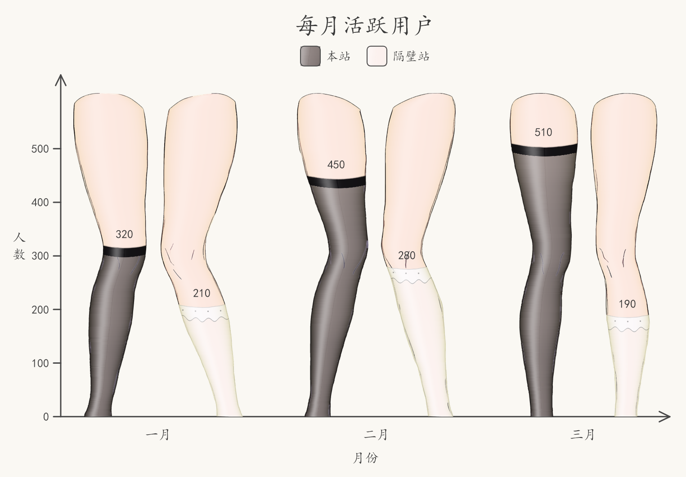
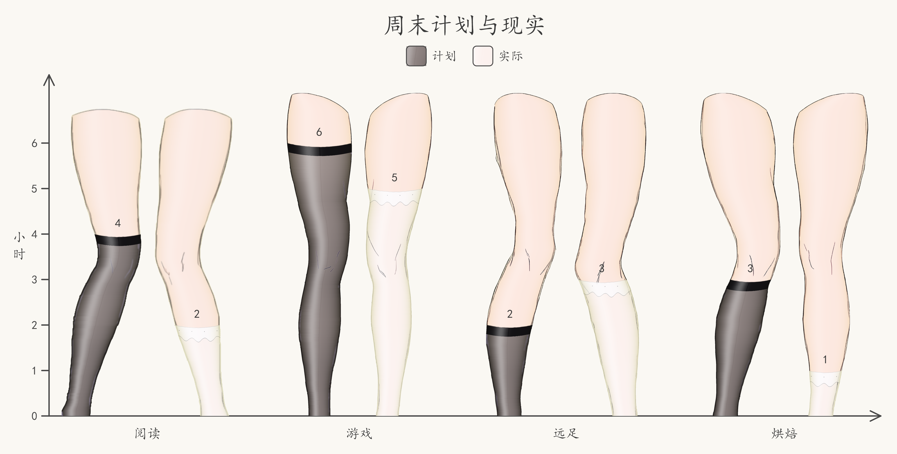
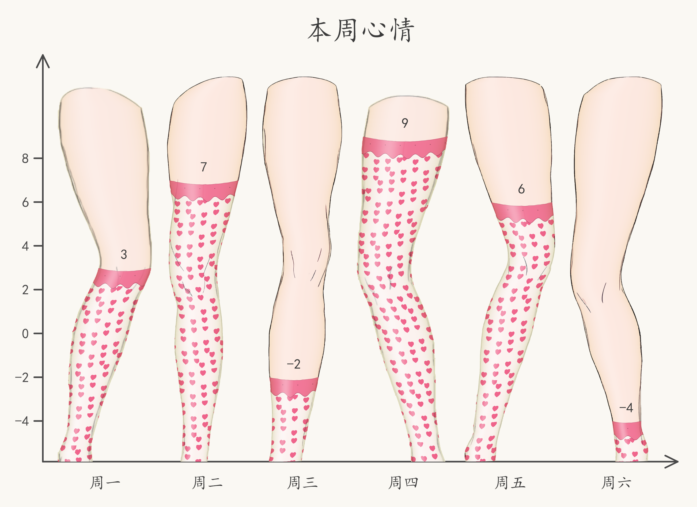
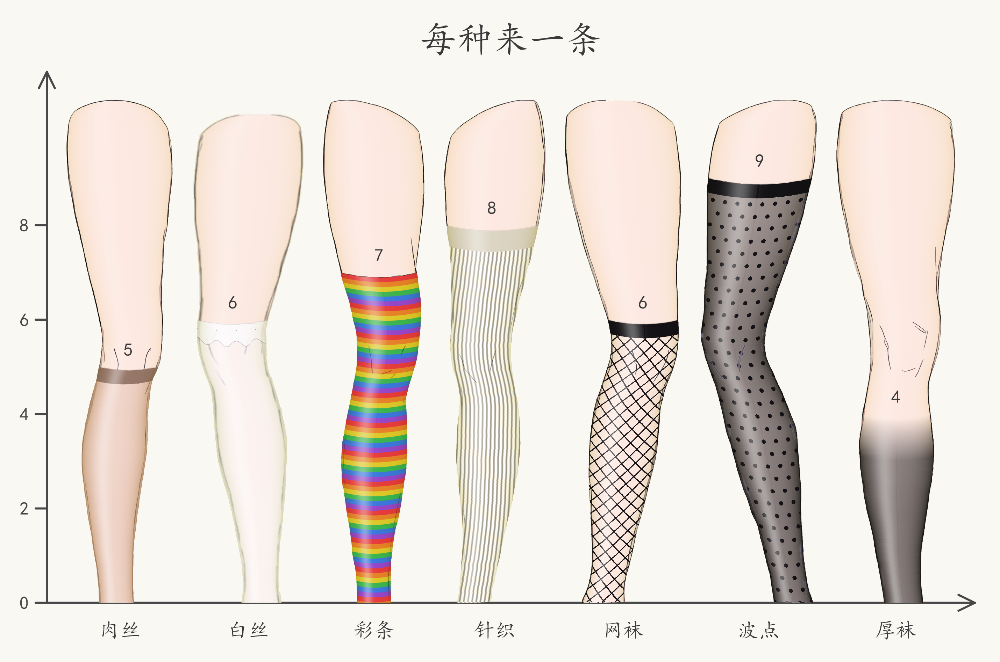
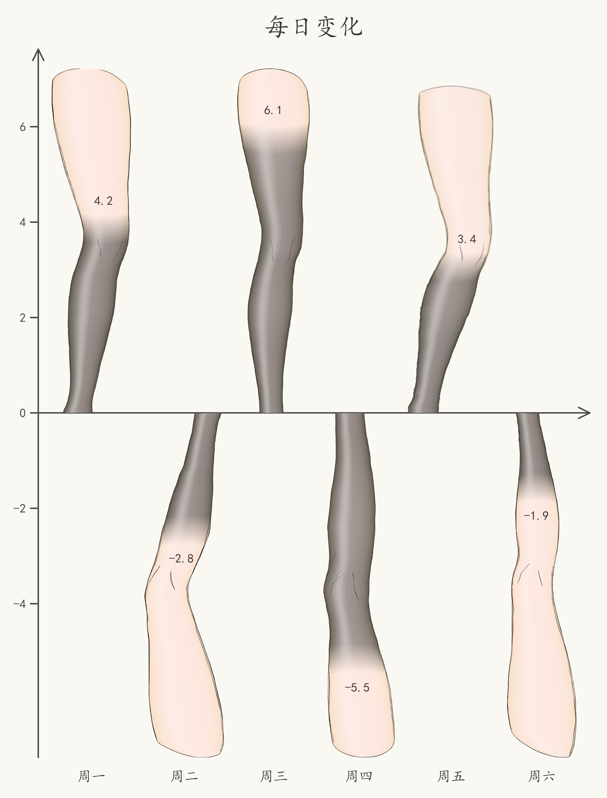

# 丝袜统计图 (Stock Chart)

[English](README.md) | 简体中文

[](https://pypi.org/project/stockchart/)
[](https://www.python.org/)
[](LICENSE)
[](ASSETS-LICENSE)

**用丝袜被拉起的高度表示数据的创意绘图库。**



`stockchart` 是柱状图的一种有趣替代：每个数值对应一条腿上丝袜被拉起的高度，
数值越大丝袜越高，0 则是一条裸腿。它适合信息图、幻灯片、海报，以及任何希望
图表更有个性、而不只是“标准”的场合。

- **数值 → 丝袜高度**：支持分组、成对，以及正负值上下镜像。
- **19 种内置样式**：透肉丝袜、厚袜、条纹、针织、网袜、波点、爱心、蕾丝边等。
- **支持常见数据类型**：列表、NumPy 数组、字典、pandas `DataFrame` / `Series`。
  pandas 是可选依赖，库本身不会 import 它。
- **原生高分辨率输出**：丝袜纹理与光影按目标像素密度重新生成，不是把小图放大。
- **分层可组合**：一行 `bar()` 即可出图；需要自由排版时可下沉到逐像素放置。
- **不依赖 matplotlib**：文字与线条由 Skia 渲染，逐字符字体回退，中文可正常显示。

<table>
  <tr>
    <td width="50%" align="center">
      <br>
      <sub>分组图 —— <code>black_sheer</code>（松紧袜口）与 <code>white_sheer</code>（蕾丝边）</sub>
    </td>
    <td width="50%" align="center">
      <br>
      <sub>单系列含负值 —— 依旧全是朝上的腿（<code>heart_white</code>）</sub>
    </td>
  </tr>
  <tr>
    <td width="62%" align="center">
      <br>
      <sub>样式巡礼 —— 5 种袜身、4 种上沿</sub>
    </td>
    <td width="38%" align="center">
      <br>
      <sub>镜像图 —— 正负值上下分布</sub>
    </td>
  </tr>
</table>

## 安装

```bash
pip install stockchart
```

或使用 [uv](https://docs.astral.sh/uv/)：

```bash
uv add stockchart
```

需要 Python 3.12 或更高版本。运行时依赖只有 `skia-python`、`numpy`、`pillow`。

## 快速开始

```python
from stockchart import bar

bar(
    [[320, 210], [450, 280], [510, 190]],
    labels=["一月", "二月", "三月"],
    series_labels=["本站", "隔壁站"],
    title="每月活跃用户",
    xlabel="月份",
    ylabel="人数",
    style=["black_sheer", "white_sheer"],
    value_labels=True,
    seed=2,
).save("chart.png")
```

输出就是本文顶部那张图。`bar()` 会自动完成数值映射、选腿、分组布局与坐标轴绘制，
返回一个可以直接 `.save()`、也可以继续微调的 `BarPlot`。

正负值镜像图：

```python
from stockchart import mirror_bar

mirror_bar(
    [4.2, -2.8, 6.1, -5.5, 3.4, -1.9],
    labels=["周一", "周二", "周三", "周四", "周五", "周六"],
    title="每日变化",
    style="gray_sheer",
    value_labels=True,
    seed=2,
).save("mirror.png")
```

## 数据输入

直接传入手头的数据结构即可：

| 输入 | 解释 |
| --- | --- |
| 一维列表 / 元组 / 序列 | 单系列 |
| 二维序列 `(组数, 系列数)` | 分组数据 |
| `numpy.ndarray` | 一维或二维数组 |
| 标量值字典 | 键作 x 轴标签，单系列 |
| 等长序列字典 | 键作系列名，并自动生成图例 |
| pandas `DataFrame` | index → x 标签，columns → 系列名 |
| pandas `Series` | index → x 标签，单系列 |
| `PlotData` | 已归一化的数据 |

例如 DataFrame 会自动带上标签和图例：

```python
import pandas as pd
from stockchart import bar

df = pd.DataFrame(
    {"本站": [320, 450, 510], "隔壁站": [210, 280, 190]},
    index=["一月", "二月", "三月"],
)
bar(df, title="每月活跃用户", style=["black_sheer", "white_sheer"]).save("chart.png")
```

显式传入的 `labels=` / `series_labels=` 会覆盖从数据推断出的值。自定义容器可以用
`register_data_type` 注册，详见
[数据输入参考](docs/api.zh-CN/data-input.md)。

## 丝袜样式

传一个预设名，或用列表让样式循环：

```python
bar(
    [5, 6, 7, 8, 6, 9, 4],
    labels=["肉丝", "白丝", "彩条", "针织", "网袜", "波点", "厚袜"],
    title="每种来一条",
    style=[
        "nude_sheer",
        "white_sheer",
        "stripe_rainbow",
        "knit_cream",
        "fishnet_black",
        "polka_black",
        "black_pantyhose",
    ],
    value_labels=True,
    seed=3,
)
```

19 个预设覆盖透肉丝袜、厚袜、条纹、针织、网袜、波点、爱心、蕾丝边等。需要更细的
控制时，可以直接构造 `StockingStyle`：袜身用 `Plain` / `Striped` / `Ribbed` /
`Fishnet` / `Dotted`，上沿用 `Bare` / `Welt` / `Lace` / `Fade`。完整样式表见
[渲染原语参考](docs/api.zh-CN/rendering.md)。

## 标题、轴名与选项

```python
bar(
    [[320, 210], [450, 280], [510, 190]],
    labels=["一月", "二月", "三月"],
    series_labels=["本站", "隔壁站"],
    title="每月活跃用户",  # 默认在绘图区上方居中
    xlabel="月份",
    ylabel="人数",
    title_align="left",  # 需要时改回左对齐
    grid=True,
    axis_style="handdrawn",
    legend_loc="bottom",
)
```

图表语义参数留在函数签名里；`grid`、`axis_style`、`legend_loc`、`legend_ncol`、
`x_label_rotation`、`bar_gap`、`group_gap` 等下层选项通过类型化的选项包透传。
完整列表见
[`ChartOptions` 表](docs/api.zh-CN/charts.md)。

## API 分层

库里刻意分成五层，按需要的控制力选择即可：

| 层 | 提供什么 | 入口 |
| --- | --- | --- |
| L0 素材 | 腿素材的元数据与内置图形 | `Leg`、`LegLibrary`、`load_leg` |
| L1 渲染原语 | 单条丝袜、文字、手绘线条 | `render_stocking`、`StockingStyle`、`STYLES`、`draw_text`、`sketch_*` |
| L2 自由柱状图 | 画布、基线、任意位置贴腿 | `BarPlot`、`Scale`、`Canvas` |
| L3 布局封装 | 统一间距、自动选腿 | `add_bars`、`add_grouped_bars`、`add_paired_bars` |
| L4 一行出图 | 数据归一 + 全自动布局 | `bar`、`mirror_bar` |

例如 L2/L3 可以自己摆放每一条腿：

```python
from stockchart import BarPlot, Scale

plot = BarPlot(1200)
plot.add_bars([300, 500, 400], style="black_sheer")
plot.add_x_labels(["A", "B", "C"])
plot.add_y_axis(Scale((0, 500), (0, 760)))
plot.add_title("自由排版")
plot.save("chart.png")
```

## 输出

`BarPlot` 输出 PNG，也可以直接拿 PIL Image 或 NumPy 数组：

```python
plot.save("chart.png", scale=2)  # 2 倍像素密度的 PNG
image = plot.to_pil()
array = plot.to_numpy()
```

`scale` 控制输出像素密度；丝袜纹理与光影会按该密度重新生成。库不提供 SVG / PDF
输出：袜身是逐像素算法，转矢量需要另写渲染器，输出只有 PNG。

## 文档

- [API 参考](docs/api.zh-CN/index.md)——每层一页
- [设计说明](docs/design.zh-CN.md)

## 开发

```bash
git clone https://github.com/xie-huaaaan/stockchart.git
cd stockchart
uv sync
uv run python -m pytest
uv run ruff check . && uv run ruff format .
uv run python -m pyright
```

欢迎提 issue 或 PR。

## 状态

`0.1.x` 是早期公开版本。渲染管线已经稳定，但公开 API 仍可能在小版本中调整。

## 许可证

Copyright © 2026 xie-huaaaan。

源代码以 [Mozilla Public License 2.0](LICENSE)（MPL-2.0）发布。你可以在闭源项目中
使用 `stockchart`；如果修改了受 MPL 覆盖的源文件，这些文件需要继续以 MPL-2.0 提供。

内置腿部素材（`src/stockchart/assets/leg_*.svg` 与 `legs.json`）为
**All Rights Reserved（保留所有权利）**，不在 MPL-2.0 覆盖范围内，详见
[素材许可](ASSETS-LICENSE)。素材可用于通过 `stockchart` 渲染图表，
你生成的图表归你所有；素材本身除作为未修改的完整软件包的一部分外，不得单独提取或再分发。
