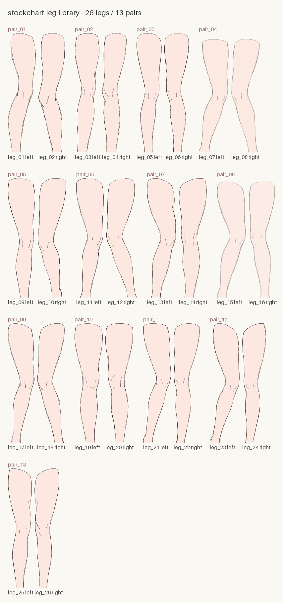

# L0 — 腿部素材

← [API 索引](index.md) · 相关：[L1 — 渲染原语](rendering.md) · [L2 — 自由柱状图](barplot.md)



26 条腿 / 13 对，每条腿都是透明 SVG。编号与配对一经发布不再变动。

内置素材另带预制的矢量绘图指令与墨线数据以减少首次计算；矢量指令按素材摘要和 Skia 版本校验，不匹配时自动从 SVG 重建，并在进程内按内存预算共享缓存。绘制仍在目标像素密度下光栅化，没有改为缩放预制位图。

| pair | 左腿 | 右腿 | 设计宽度 |
| --- | --- | --- | --- |
| pair_01 | leg_01 | leg_02 | 169 / 159 |
| pair_02 | leg_03 | leg_04 | 149 / 149 |
| pair_03 | leg_05 | leg_06 | 152 / 148 |
| pair_04 | leg_07 | leg_08 | 179 / 173 |
| pair_05 | leg_09 | leg_10 | 165 / 173 |
| pair_06 | leg_11 | leg_12 | 166 / 183 |
| pair_07 | leg_13 | leg_14 | 178 / 167 |
| pair_08 | leg_15 | leg_16 | 176 / 159 |
| pair_09 | leg_17 | leg_18 | 159 / 166 |
| pair_10 | leg_19 | leg_20 | 170 / 169 |
| pair_11 | leg_21 | leg_22 | 169 / 158 |
| pair_12 | leg_23 | leg_24 | 181 / 145 |
| pair_13 | leg_25 | leg_26 | 145 / 150 |

内置与外部素材共用 `Leg`、目标倍率栅格化与缓存链路。`DEFAULT_LEG_LIBRARY` 是默认内置库；`LegLibrary([...])` 可混合外部腿和部分内置腿。导入素材须已按预期方向准备好，不做翻转、裁切或尺寸归一化。PNG 的设计尺寸等于图片大小；SVG 使用绝对像素宽高，缺少时使用 `viewBox`（仅缺一边时按其宽高比补足）。无可解析绝对尺寸或有效 `viewBox` 的百分比尺寸会报错。锚点省略时按底部最多 20 个设计像素的 alpha 质心估算，底部透明时取水平中心。

样式中的袜口、条纹、网眼等长度均为固定设计像素，不随素材高度归一化。外部素材的许可由提供者负责；内置素材及其派生数据沿用 ARR 许可。

未填写配对字段的腿仍可通过 `legs` 访问并参与普通选腿。`paired="none"` 从全部腿中选择；`"group"` / `"global"` 只取完整左右配对，没有完整配对时抛 `ValueError`。`"auto"` 在多系列时等同 `"global"`，因此仅含未配对素材的库绘制多系列图时应显式传 `paired="none"`。

```python
@dataclass(slots=True, frozen=True)
class Leg:
    """一条腿部素材：不可变源字节与设计像素元数据。

    所有几何值均使用设计像素。来源方向由素材提供者保证：脚应位于底部，
    素材应已按预期方向准备好。

    Args:
        source: PNG 或 SVG 原始字节。
        source_type: 素材格式。
        width: 设计像素宽。
        height: 设计像素高。
        foot_center_x: 足底中心的设计坐标 x。
        leg_id: 可选的库内腿标识。
        pair_id: 可选的配对标识；只有同时提供 side 才参与配对。
        side: 可选的左右侧。

    Raises:
        ValueError: 源为空、格式无效、尺寸非正或足底锚点越界。

    Attributes:
        source: 原始 PNG 或 SVG 字节。
        source_type: 素材格式。
        width: 设计像素宽。
        height: 设计像素高。
        foot_center_x: 足底中心的设计坐标 x。
        leg_id: 可选的腿标识。
        pair_id: 可选的配对标识。
        side: 可选的左右侧。
    """

    source: bytes
    source_type: Literal["png", "svg"]
    width: float
    height: float
    foot_center_x: float
    leg_id: str | None = None
    pair_id: str | None = None
    side: Literal["left", "right"] | None = None

    def raster_at(self, scale: float = 1.0) -> NDArray[np.uint8]:
        """将素材按目标输出倍率栅格化，并复用进程内共享缓存。

        Args:
            scale: 输出像素 / 设计像素。

        Returns:
            (round(height × scale), round(width × scale), 4) uint8 RGBA 只读数组。

        Raises:
            ValueError: scale 不是正的有限数，或素材源无法解码。
        """
        ...
```

```python
@dataclass(slots=True, frozen=True)
class LegRender:
    """一条腿在指定倍率下的栅格化绘制结果。

    Attributes:
        source: 生成该图像的不可变素材。
        image: 目标倍率下的 uint8 RGBA 像素。
        scale: 输出像素 / 设计像素。
    """

    source: Leg
    image: NDArray[np.uint8]
    scale: float
```

```python
class LegLibrary:
    """由内置或外部素材组成的不可变腿库，像素按需生成。

    Args:
        legs: 素材序列；None 使用内置库，可混入默认库中的 Leg。
        seed: 选腿方法的默认种子；方法级 seed 优先，不记录随机状态。

    Raises:
        ValueError: 自定义库为空、腿标识重复、同一配对的左右侧重复，
            或内置元数据无效。
    """

    def __init__(self, legs: Sequence[Leg] | None = None, *, seed: int | None = None) -> None: ...

    @property
    def legs(self) -> tuple[Leg, ...]:
        """按库内顺序返回全部腿，包括无标识或未配对素材。

        Returns:
            只读 Leg 元组；内置腿的源文件在首次访问时读取，不生成预览。
        """
        ...

    @property
    def leg_ids(self) -> tuple[str, ...]:
        """返回按编号排序的非空腿标识，不加载素材源。"""
        ...

    @property
    def pair_ids(self) -> tuple[str, ...]:
        """返回按编号排序的完整配对标识，不加载素材源。"""
        ...

    def get(self, leg_id: str) -> Leg:
        """按标识取一条腿。

        Args:
            leg_id: 库中已有的腿标识。

        Returns:
            同一库内反复访问返回同一个 Leg。

        Raises:
            KeyError: 标识不存在。
        """
        ...

    def pair(self, pair_id: str) -> tuple[Leg, Leg]:
        """按配对标识取 (左腿, 右腿)。

        Args:
            pair_id: 完整配对标识。

        Returns:
            对应的左腿、右腿。

        Raises:
            KeyError: 配对不存在或不完整。
        """
        ...

    def alternate(self, n: int, *, paired: bool = False, seed: int | None = None) -> list[Leg]:
        """选取 n 条腿；成对时按左、右顺序展开完整配对。

        Args:
            n: 所需腿数。
            paired: False 从全部腿中打乱选取；True 仅使用完整配对，奇数末项取左腿。
            seed: 本次选择的随机种子，不受此前调用影响；None 使用库默认种子或每次随机。

        Returns:
            优先不重复、数量不足时循环复用的 Leg 列表。

        Raises:
            ValueError: n 为负数，或成对选取时没有完整配对。
        """
        ...

    def sample_pairs(self, n: int, *, seed: int | None = None) -> list[tuple[Leg, Leg]]:
        """按本次 seed 选取 n 个完整左右配对。

        Args:
            n: 所需配对数。
            seed: 本次选择的随机种子；None 使用库默认种子或每次随机。

        Returns:
            优先不重复、数量不足时循环复用的 (左腿, 右腿) 列表。

        Raises:
            ValueError: n 为负数，或 n 大于零而库中没有完整配对。
        """
        ...

    def preview(self, *, scale: float = 0.5) -> Image.Image:
        """生成全部素材的目录图，完整配对相邻，未配对腿单独展示。

        Args:
            scale: 相对设计尺寸的预览倍率，须为正的有限数。

        Returns:
            标注库内标识、配对与左右侧的 RGB 模式 PIL Image。

        Raises:
            ValueError: scale 不是正的有限数。
        """
        ...
```

```python
def load_leg(
    path: str | Path,
    *,
    foot_center_x: float | None = None,
    leg_id: str | None = None,
    pair_id: str | None = None,
    side: Literal["left", "right"] | None = None,
) -> Leg:
    """从 PNG 或 SVG 加载一条外部素材。

    Args:
        path: PNG 或 SVG 文件路径。
        foot_center_x: 足底中心设计坐标；省略时按底部 alpha 质心估算。
        leg_id: 可选的库内标识。
        pair_id: 可选的配对标识。
        side: 可选的左右侧；需与 pair_id 同时提供才参与配对。

    Returns:
        统一的不可变 `Leg` 素材源。

    Raises:
        OSError: 文件无法读取。
        ValueError: 格式、尺寸或锚点无效。
    """
    ...
```

## 最小示例

```python
from stockchart import DEFAULT_LEG_LIBRARY, LegLibrary, STYLES, load_leg, render_stocking

leg = DEFAULT_LEG_LIBRARY.get("leg_03")
custom = load_leg("custom.svg", leg_id="custom")
library = LegLibrary([leg, custom])
rendered = render_stocking(custom, STYLES["black_sheer"], 200, scale=2, seed=0)
print(rendered.source.height, rendered.image.shape, rendered.scale)
```
