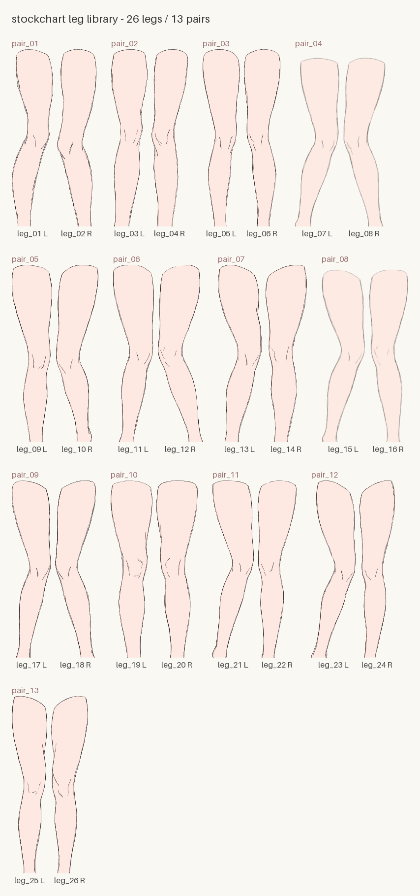

# L0 — 腿部素材

← [API 索引](index.md) · 相关：[L1 — 渲染原语](rendering.md) · [L2 — 自由柱状图](barplot.md)



26 条腿 / 13 对，每条腿都是透明 SVG。编号与配对一经发布不再变动。

| pair | 左腿 | 右腿 | 设计宽度 |
| --- | --- | --- | --- |
| pair_01 | leg_01 | leg_02 | 169 / 159 |
| pair_02 | leg_03 | leg_04 | 149 / 149 |
| pair_03 | leg_05 | leg_06 | 152 / 148 |
| pair_04 | leg_07 | leg_08 | 179 / 173 |
| pair_05 | leg_09 | leg_10 | 165 / 173 |
| pair_06 | leg_11 | leg_12 | 166 / 183 |
| pair_07 | leg_13 | leg_14 | 178 / 167 |
| pair_08 | leg_15 | leg_16 | 176 / 159 |
| pair_09 | leg_17 | leg_18 | 159 / 166 |
| pair_10 | leg_19 | leg_20 | 170 / 169 |
| pair_11 | leg_21 | leg_22 | 169 / 158 |
| pair_12 | leg_23 | leg_24 | 181 / 145 |
| pair_13 | leg_25 | leg_26 | 145 / 150 |

```python
@dataclass(slots=True, frozen=True)
class Leg:
    """一条腿部素材：定位元数据 + 透明 SVG 源（或 RGBA 像素）。

    宽高、足底中心等元数据一律使用**设计像素**（腿高 720 的坐标系）。
    内置素材带 `svg`：`image` 只是设计尺寸的布局预览，渲染时按目标倍率
    重新栅格化；外部 PNG 素材没有 `svg`，`image` 就是原始位图。

    Attributes:
        image: (H, W, 4) uint8；脚在图像底端、素材正放。内置素材为设计尺寸，
            外部素材为 PNG 原尺寸。
        width: 设计像素宽。
        height: 设计像素高。
        foot_center_x: 足底中心在设计坐标系里的 x，放置对齐的锚点。
        pixels_per_unit: `image` 像素 / 设计像素。内置素材与外部位图均为 1。
        leg_id: 内置素材编号（如 "leg_03"）；外部素材为 None。
        pair_id: 所属配对编号（如 "pair_02"）；外部素材为 None。
        side: "left" / "right"；外部素材为 None。
        svg: 内置透明 SVG 源；外部素材为 None。渲染时按目标倍率栅格化。

    Methods:
        raster_at(pixels_per_unit): 按目标密度直接把 `svg` 渲染成位图，
            结果缓存在 Leg 上。没有 `svg` 的外部素材抛 ValueError。
        at_density(pixels_per_unit): 返回该密度下可直接绘制的 Leg；密度相同
            时返回自身。`render_stocking(scale=)` 内部使用。
    """

    image: np.ndarray
    width: int
    height: int
    foot_center_x: int
    pixels_per_unit: float = 1.0
    leg_id: str | None = None
    pair_id: str | None = None
    side: Literal["left", "right"] | None = None
    svg: bytes | None = None
```

```python
class LegLibrary:
    """内置腿部素材库（26 条腿 / 13 对；每条腿是透明 SVG）。"""

    def __init__(self, *, seed: int | None = None) -> None:
        """seed 作为后续自动选腿的随机源；不传则每次运行随机。"""

    @property
    def leg_ids(self) -> tuple[str, ...]:
        """全部腿编号，按编号排序。"""

    @property
    def pair_ids(self) -> tuple[str, ...]:
        """全部配对编号，按编号排序。"""

    def get(self, leg_id: str) -> Leg:
        """按编号取一条腿，如 get("leg_03")。"""

    def pair(self, pair_id: str) -> tuple[Leg, Leg]:
        """取一对腿，返回 (左腿, 右腿)。"""

    def alternate(self, n: int, *, paired: bool = False) -> list[Leg]:
        """按左、右、左、右……的顺序选出 n 条腿。

        paired=False（默认）时每条腿来自不同素材对；paired=True 时相邻
        两条腿组成一对（左、右），素材对按 seed 伪随机、优先不重复。
        n 为奇数时最后一对只取左腿；超过 13 对后继续复用。
        """

    def sample_pairs(self, n: int) -> list[tuple[Leg, Leg]]:
        """选出 n 对完整素材（成对布局用），选取规则同 alternate。"""

    def preview(self, *, scale: float = 0.5) -> PIL.Image.Image:
        """生成全部内置素材的目录图，按配对分组并标注编号与左右脚。"""
```

```python
def load_leg(
    png: str | Path,
    *,
    foot_center_x: int | None = None,
) -> Leg:
    """从 PNG 加载自定义腿素材，用法与内置素材一致（编号字段为 None）。

    Args:
        png: 带透明通道的 PNG 路径；要求脚位于图像底端（与内置素材同方向）。
        foot_center_x: 足底中心 x 坐标。缺省按底部若干行的 alpha 质心自动估计。

    Returns:
        自定义素材的 Leg 实例，可直接传入各层接口；`svg` 为 None，
        `pixels_per_unit` 为 1（不做多分辨率识别）。
    """
```
