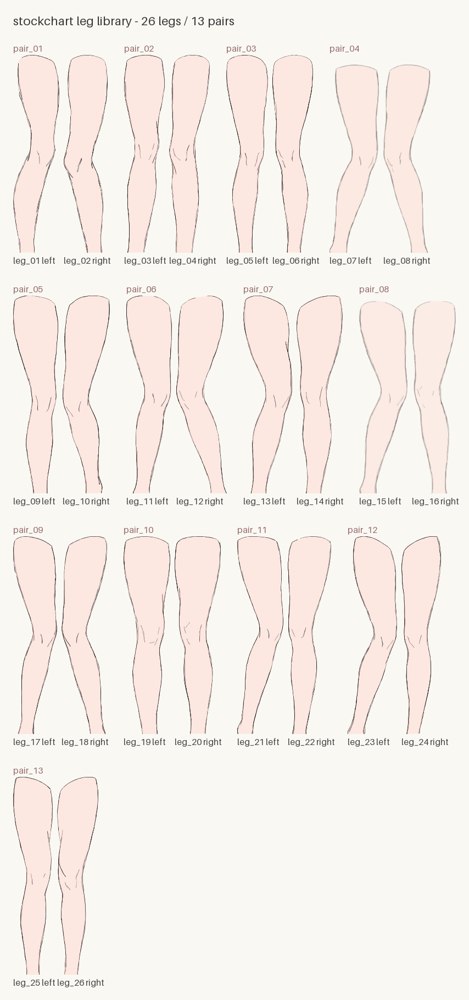

# L0 — leg assets

← [API index](index.md) · Related: [L1 rendering primitives](rendering.md) · [L2 free-form bar plot](barplot.md)



26 legs / 13 pairs; every leg is a transparent SVG. IDs and pairings are frozen once published.

| pair | left leg | right leg | design widths |
| --- | --- | --- | --- |
| pair_01 | leg_01 | leg_02 | 169 / 159 |
| pair_02 | leg_03 | leg_04 | 149 / 149 |
| pair_03 | leg_05 | leg_06 | 152 / 148 |
| pair_04 | leg_07 | leg_08 | 179 / 173 |
| pair_05 | leg_09 | leg_10 | 165 / 173 |
| pair_06 | leg_11 | leg_12 | 166 / 183 |
| pair_07 | leg_13 | leg_14 | 178 / 167 |
| pair_08 | leg_15 | leg_16 | 176 / 159 |
| pair_09 | leg_17 | leg_18 | 159 / 166 |
| pair_10 | leg_19 | leg_20 | 170 / 169 |
| pair_11 | leg_21 | leg_22 | 169 / 158 |
| pair_12 | leg_23 | leg_24 | 181 / 145 |
| pair_13 | leg_25 | leg_26 | 145 / 150 |

```python
@dataclass(slots=True, frozen=True)
class Leg:
    """One leg asset: placement metadata plus a vector source (or RGBA pixels).

    Width, height, foot center and the other metadata always use **design pixels**
    (the coordinate system where a leg is 720 tall). Built-in assets carry an
    `svg` vector source: `image` is only a layout preview at design size, and
    the real rendering re-rasterizes the SVG at the target scale via
    `render_stocking(scale=)`; external PNG assets have no vector source, so
    their `image` is the original bitmap.

    Attributes:
        image: (H, W, 4) uint8 RGBA; the foot sits at the bottom of the image
            and the asset is upright. Built-in assets are at design size; external
            assets keep their original PNG size.
        width: width in design pixels.
        height: height in design pixels.
        foot_center_x: x of the foot-sole center in the design coordinate system;
            the anchor used when placing the leg.
        pixels_per_unit: `image` pixels per design pixel. 1 for built-in assets
            (layout preview) and 1 for external assets.
        leg_id: built-in asset id (e.g. "leg_03"); None for external assets.
        pair_id: the id of the pair it belongs to (e.g. "pair_02"); None for
            external assets.
        side: "left" / "right"; None for external assets.
        svg: the transparent SVG source of a built-in asset; None for external
            assets. Rasterized at the target scale when rendering.

    Raises:
        ValueError: width or height is not positive, pixels_per_unit is not
            positive, foot_center_x is out of range, or image is not a uint8 RGBA
            array matching the design size and density.
    """

    image: np.ndarray
    width: int
    height: int
    foot_center_x: int
    pixels_per_unit: float = 1.0
    leg_id: str | None = None
    pair_id: str | None = None
    side: Literal["left", "right"] | None = None
    svg: bytes | None = None

    def raster_at(self, pixels_per_unit: float) -> np.ndarray:
        """Rasterize at the target density and share read-only pixel caches across the process.

        Args:
            pixels_per_unit: target pixels / design pixels.

        Returns:
            (height × pixels_per_unit, width × pixels_per_unit, 4) uint8 RGBA.

        Raises:
            ValueError: pixels_per_unit is not a positive finite number, or the asset
                has no vector source.
        """

    def at_density(self, pixels_per_unit: float) -> Leg:
        """Return a Leg directly drawable at the given density, reusing a cached bitmap.

        Args:
            pixels_per_unit: target pixels / design pixels.

        Returns:
            A new Leg: `image` is at the target density and `pixels_per_unit` is
                updated to match; the design metadata and the SVG source stay
                unchanged.

        Raises:
            ValueError: pixels_per_unit is not a positive finite number, or the asset
                has no vector source.
        """
```

```python
class LegLibrary:
    """Library of built-in leg assets (26 legs / 13 pairs).

    All Leg objects are lazily loaded and cached on first access; repeated calls
    to get/pair do not re-read from disk. seed only affects the automatic
    leg-selection order, not the assets themselves.

    Args:
        seed: random source for subsequent automatic leg selection; omit for a
            fresh random run each time.

    Raises:
        ValueError: the packaged legs.json is missing or fails validation.
    """

    def __init__(self, *, seed: int | None = None) -> None: ...

    @property
    def leg_ids(self) -> tuple[str, ...]:
        """All leg ids.

        Returns:
            A tuple of leg_id in ascending id order.
        """

    @property
    def pair_ids(self) -> tuple[str, ...]:
        """All pair ids.

        Returns:
            A tuple of pair_id in ascending id order.
        """

    def get(self, leg_id: str) -> Leg:
        """Fetch one leg by id (e.g. leg_03).

        Args:
            leg_id: built-in leg id, of the form "leg_NN".

        Returns:
            The matching Leg instance (lazily loaded).

        Raises:
            KeyError: the id does not exist.
        """

    def pair(self, pair_id: str) -> tuple[Leg, Leg]:
        """Fetch a pair of legs, returning (left leg, right leg).

        Args:
            pair_id: pair id, of the form "pair_NN".

        Returns:
            (left leg, right leg).

        Raises:
            KeyError: the pair id does not exist.
        """

    def alternate(self, n: int, *, paired: bool = False) -> list[Leg]:
        """Select n legs in left, right, left, right ... order.

        Once the asset pairs exceed 13, selection keeps reusing already-used assets.

        Args:
            n: number of legs wanted.
            paired: with False (default) every leg comes from a different asset pair;
                with True two adjacent legs form a pair (left, right), the asset pairs
                are pseudo-random by seed and avoid repeats where possible. When n is
                odd the last pair contributes only its left leg.

        Returns:
            A list of n Leg items; even indices (0-based) hold left legs and odd
            indices hold right legs.

        Raises:
            ValueError: n is negative.
        """

    def sample_pairs(self, n: int) -> list[tuple[Leg, Leg]]:
        """Select n complete asset pairs (for paired layouts); same selection rules as alternate.

        Args:
            n: number of pairs wanted.

        Returns:
            A list of n (left leg, right leg) tuples.

        Raises:
            ValueError: n is negative.
        """

    def preview(self, *, scale: float = 0.5) -> PIL.Image.Image:
        """Build a catalog image of all built-in assets, for browsing and asset selection.

        Laid out grouped by pair (4 pairs per row), labeled with pair_id, leg_id and
        the left/right foot.
        This is a browsing tool, not on the rendering hot path; the first call loads
        all leg assets.

        Args:
            scale: the scale of the preview image relative to the design size; must
                be positive.

        Returns:
            An RGB-mode PIL Image.

        Raises:
            ValueError: scale is not a positive finite number.
        """
```

```python
def load_leg(
    png: str | Path,
    *,
    foot_center_x: int | None = None,
) -> Leg:
    """Load a custom leg asset from a PNG, usable like the built-in assets (the id fields are None).

    Args:
        png: path to a PNG with an alpha channel; the foot must sit at the bottom
            of the image (the same orientation as the built-in assets).
        foot_center_x: x coordinate of the foot-sole center. By default it is
            estimated automatically from the alpha centroid of the bottom rows.

    Returns:
        A Leg instance for the custom asset, passable directly to the interfaces
        of every layer.

    Raises:
        OSError: the file cannot be opened or is not a recognizable image.
        ValueError: foot_center_x is outside the image width.
    """
```

## Minimal example

```python
from stockchart import LegLibrary

library = LegLibrary(seed=0)
leg = library.get("leg_03")  # a single leg
left, right = library.pair("pair_02")  # a pair (left, right)
print(leg.width, leg.height, leg.foot_center_x)
print(library.leg_ids[:3], library.pair_ids[:3])
```
